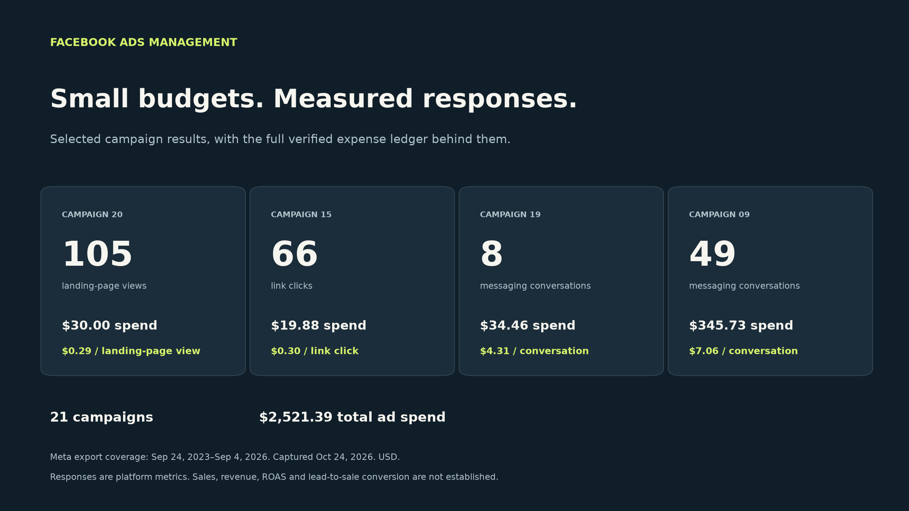
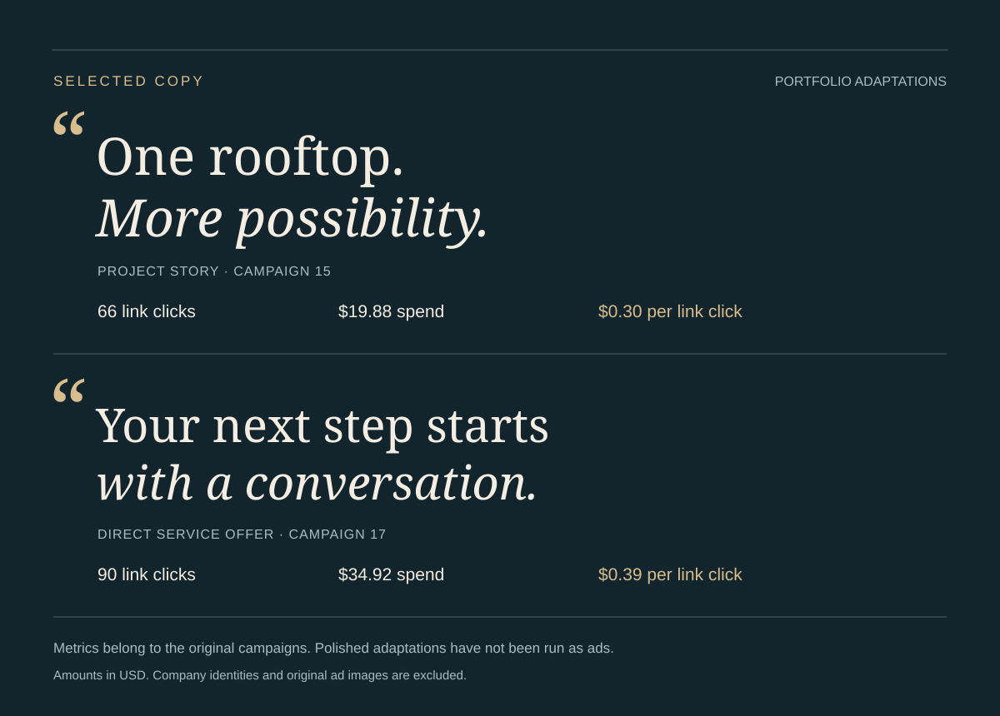
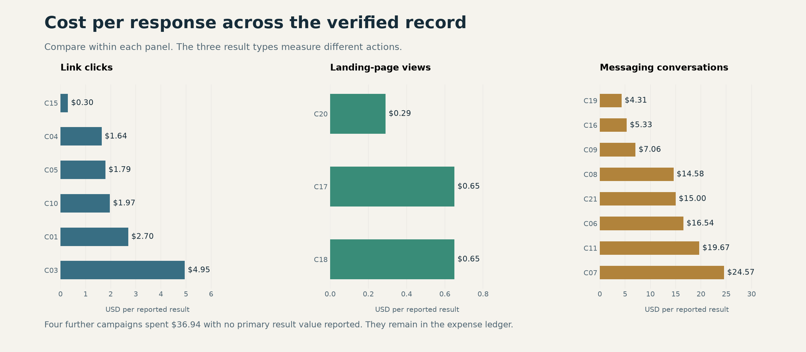

# Facebook Ads Management

An anonymized portfolio of actual campaign spend and platform-reported responses. Selected low-cost results lead the story. A complete ledger of the 21 verified export records makes the surrounding expenses inspectable.

[Selected results](docs/CASES.md) · [Ad copy and clicks](docs/COPYWRITING.md) · [Expense breakdown](docs/EXPENSES.md) · [Measurement and privacy](docs/METHOD.md) · [Download CSV](data/campaigns.csv) · [JSON data](data/campaigns.json)

## Selected results

| Campaign | Ad spend | Reported response | Cost per response | Detail |
|---|---:|---|---:|---|
| Campaign 20 | $30.00 | 105 landing-page views | $0.29 | [Inspect](docs/CASES.md#campaign-20) |
| Campaign 15 | $19.88 | 66 link clicks | $0.30 | [Inspect](docs/CASES.md#campaign-15) |
| Campaign 19 | $34.46 | 8 messaging conversations started | $4.31 | [Inspect](docs/CASES.md#campaign-19) |
| Campaign 09 | $345.73 | 49 messaging conversations started | $7.06 | [Inspect](docs/CASES.md#campaign-09) |

These are observed unit costs within the accessible record. They demonstrate economical delivery of measured responses. Revenue and sales conversion were not verified, so no ROAS or turnover claim is made.

## Ad copy and clicks

**The post text below is anonymized and adapted for this portfolio.** Identifying wording and project details have been rewritten. The numbers show the original campaigns' reported outcomes; these adaptations have not been run as new ads.

### Project story · Campaign 15

**Post copy**

> **One rooftop. More possibility.**
>
> A recent residential solar installation turns rooftop space into a source of energy for the home. Considering solar? Explore what a system could look like for your property and how it fits your household's priorities.

| Link clicks | Ad spend | Cost per link click | Landing-page views |
|---:|---:|---:|---:|
| **66** | **$19.88** | **$0.30** | **32** |

**Writing approach:** a concise project hook, a homeowner benefit and an invitation to explore the service. [Read the copy details and campaign evidence](docs/COPYWRITING.md#campaign-15--project-story).

### Direct service offer · Campaign 17

**Post copy**

> **Your next step starts with a conversation.**
>
> Speak directly with the team that reviews your roof, plans the system and handles the installation. Find out what a solar project could look like for your home. Request a free assessment.

| Link clicks | Ad spend | Cost per link click | Landing-page views |
|---:|---:|---:|---:|
| **90** | **$34.92** | **$0.39** | **54** |

**Writing approach:** a direct offer, an explanation of the service and a specific call to action. [Read the copy details and campaign evidence](docs/COPYWRITING.md#campaign-17--direct-service-offer).

These are separate campaign examples. Reported clicks reflect the full campaign, including creative, audience and delivery; the copy's individual contribution was not isolated.

## Every verified expense remains visible

The reviewed export contains **$2,521.39 of ad spend across 21 campaigns**. Only four campaigns are featured above. The expense ledger retains the rest, including larger spends and records without a primary result value.

| Primary result category | Matching spend | Reported primary results | Weighted unit cost |
|---|---:|---:|---:|
| Link clicks | $891.88 | 506 | $1.76 |
| Landing-page views | $89.09 | 196 | $0.45 |
| Messaging conversations started | $1,503.48 | 122 | $12.32 |
| Primary result unavailable | $36.94 | Unavailable | Unavailable |

Result categories measure different actions and are not combined into a single conversion count. Blank source results remain unavailable. Spend represents platform ad delivery cost in USD, not all-in business expenses or a billing audit.

[Open all 21 campaign expenses](docs/EXPENSES.md) for individual spend, primary counts, unit costs and reported end dates. The [CSV](data/campaigns.csv) and [JSON](data/campaigns.json) add campaign-level impressions, reach, link clicks, landing-page views and calculated click-through rates.

## The management work this demonstrates

- **Budget accountability:** reconcile every accessible exported campaign, including spend outside the featured examples.
- **Objective-specific evaluation:** compare the cost of conversations, clicks and landing-page views separately.
- **Reporting judgment:** preserve missing values, distinguish ad spend from invoices and avoid attributing sales to unverified engagement.
- **Client confidentiality:** use neutral aliases and publish only the metrics needed to evaluate the work.

## Evidence and coverage

Captured October 24, 2026 from two authenticated Meta Ads Manager exports. Both exports identify their reporting coverage as **September 24, 2023–September 4, 2026**. Campaign schedule end dates in these records fall in December 2025–August 2026. The UI selected a longer range than the downloaded files; this discrepancy is disclosed in the [method](docs/METHOD.md#source-and-reporting-dates).

The accessible record comes from one ad account. Other company performance is excluded where access and evidence were unavailable. Campaign aliases do not imply a company count. Original names, identifiers, payment details and unredacted identity-bearing screenshots are withheld. Performance graphics are reconstructed from the verified data. Ad images and source-post links are excluded. Copy examples are anonymized adaptations with the original campaign metrics shown separately. [Read the source, reconciliation and privacy notes](docs/METHOD.md).

This repository is an independent portfolio presentation. It has no affiliation with or endorsement from Meta. All amounts are USD.
